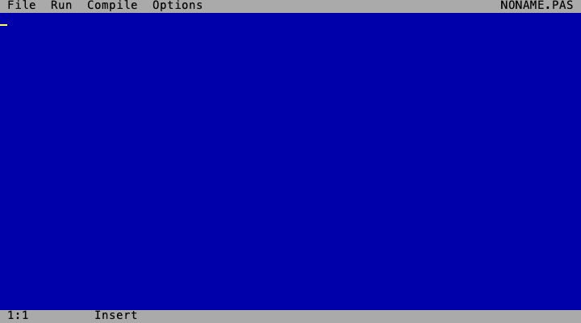

# TP5-WASM

A Turbo Pascal 5.0 work-alike. A compiler written in Rust (no dependencies) translates a
defined subset of TP 5.0 to one WebAssembly module. The runtime (`System`, `Crt`, `Dos`) and
the IDE are written in Pascal and compiled by this compiler. The compiler itself builds to a
WASM module, so the whole system runs in a browser: edit, compile and run Pascal on a
80x25 text screen.

[](https://xpqz.github.io/tpc/)

Try it in your browser: <https://xpqz.github.io/tpc/>. The first load registers a service
worker (it adds the headers the page needs for shared memory) and then opens the IDE. Press
F3 and open `DEMO`, a short Crt program; F9 compiles, Ctrl-F9 runs. `make site` builds the
site into `tmp/site/`, `make deploy-site` publishes it to the `gh-pages` branch, and
`make demo-gif` records the animation.

The compiler, runtime, IDE and host glue together are limited to 15,000 lines (counted by
`tools/loc.sh`; tests are free). The limit is there so that the code stays small enough to
read: the source is meant to be studied as a worked example of a one-pass-per-stage compiler
(lexer, parser, checker, code generator, WASM emitter). Readability wins over brevity.

Where the program and the real TP 5.0 differ, the difference is listed in
`docs/deviations.md`. Features that are left out give an error, never wrong behaviour
(`docs/subset.md`).

## Building

```
make build
```

Build output goes to the directory `scripts/cargo-target.sh` chooses: `target/` in the
checkout, unless `TPA_TARGET_ROOT` (or a one-line, git-ignored `.target-root` file at the top of
the checkout) names another directory, such as one on a faster disk; builds then go to
`<that directory>/<checkout name>`. The Makefile exports the choice as `CARGO_TARGET_DIR`. To
run `cargo` directly, set it first:

```
export CARGO_TARGET_DIR=$(scripts/cargo-target.sh)
```

The native compiler is then `$CARGO_TARGET_DIR/debug/tp5c`. The WebAssembly build of the
compiler (used by the browser) comes from:

```
make wasm
```

and is `$CARGO_TARGET_DIR/wasm32-unknown-unknown/release/tp5c.wasm`.

## Compiling and running a program

```
tp5c in.pas -o out.wasm [--dir AUXDIR]
```

Units (`uses`) and `{$I}` includes are the `.pas` and `.inc` files beside `in.pas`, then
those in `AUXDIR`, which win on a name clash. `Crt`, `Dos` and `Utils` are built in. An error
is printed as `file(line,col): Error N: message` and the exit code is 1.

`tests/run.mjs` runs a compiled module in Node:

```
node tests/run.mjs [--in INPUT] [--dir FILES] [--keys KEYS] out.wasm
```

`--in` is the console input, `--dir` a directory used as the program's file system, `--keys` a
key script for `ReadKey`. A program that uses `Crt` ends with a dump of the final screen.

Example:

```
mkdir -p tmp
echo "begin WriteLn('hi') end." > tmp/h.pas
$CARGO_TARGET_DIR/debug/tp5c tmp/h.pas -o tmp/h.wasm
node tests/run.mjs tmp/h.wasm
```

## The browser and the IDE

The page (`host/index.html`) and the Worker that runs the program share memory (the screen and
the key queue are `SharedArrayBuffer`s). Browsers offer `SharedArrayBuffer` only to
cross-origin isolated pages, so whatever serves the files must send these headers on every
response:

```
Cross-Origin-Opener-Policy: same-origin
Cross-Origin-Embedder-Policy: require-corp
```

`tools/serve.mjs` is a dev server that serves the repository root with them. Without the
headers `crossOriginIsolated` is false and the page cannot run programs; there is no fallback.

To run a program in the browser, compile it to a file inside the repository and name it in the
URL:

```
node tools/serve.mjs 8080
# http://localhost:8080/host/index.html?wasm=/tmp/h.wasm   (the repository's tmp/ directory)
```

To run the IDE in one step:

```
make ide            # PORT=8081 make ide for another port; Ctrl-C stops the server
```

It builds the IDE and the in-browser compiler into `tmp/`, starts `tools/serve.mjs` and opens
the IDE in the default browser. By hand, the same steps are: compile `ide/ide.pas` and pass the compiler module too (copy it where the
server can reach it):

```
$CARGO_TARGET_DIR/debug/tp5c ide/ide.pas -o tmp/ide.wasm
cp $CARGO_TARGET_DIR/wasm32-unknown-unknown/release/tp5c.wasm tmp/tp5c.wasm
node tools/serve.mjs 8080
# http://localhost:8080/host/index.html?wasm=/tmp/ide.wasm&compiler=/tmp/tp5c.wasm
```

The IDE's files live in the browser's `localStorage`. Run and Stop are the buttons under the
screen; Stop ends the program that is running, or the IDE when none is.

### IDE keys

| Key | Action |
|---|---|
| Arrows, Home, End, PgUp, PgDn | move |
| Ins | toggle insert and overwrite |
| Del, Backspace | delete |
| Enter | new line, indented like the line above |
| Ctrl-Y | delete the line |
| `^K B`, `^K K` | mark the block start and end |
| `^K C`, `^K V` | copy and move the block to the cursor |
| `^Q F`, Ctrl-L | find; find again |
| F2, F3 | save, open |
| F9, Ctrl-F9 | compile, run (an error puts the cursor on its line) |
| F10, Alt-F, Alt-R, Alt-C, Alt-O | menus (File, Run, Compile, Options) |
| Alt-X | quit |

A browser does not deliver Ctrl-K and Ctrl-Q to a page, so **Alt-K** and **Alt-Q** are accepted
in their place: `Alt-K B` is `^K B`, `Alt-Q F` is `^Q F` (decision 41). Every command is also in
the menus, so none depends on F9 or F10. Only the Alt-letter menu keys in the table above
exist; the bar has no Edit menu.

## VS Code

`vscode/` is an extension: Pascal highlighting, the compiler's errors as you type, and
compile and run commands. It has no dependencies and is not packaged; try it from the
repository with a throw-away profile, so that your own settings are left alone:

```
make wasm                              # builds the compiler the extension loads
code --extensionDevelopmentPath=$PWD/vscode --user-data-dir=$PWD/tmp/vscode-profile .
```

Commands (Command Palette, category TP5), with the Turbo Pascal keys in Pascal files:

- **TP5: Compile** (`F9`) writes `NAME.wasm` beside `NAME.pas`; an error is shown in the editor
  and as a message with the file, line and error number. `F9` replaces "toggle breakpoint" in
  Pascal files only.
- **TP5: Run** (`Ctrl+F9`, and the play button in the editor's title bar) compiles and runs the
  program in a terminal. The program runs in a worker thread, never in the editor. `WriteLn`
  output streams to the terminal, `ReadLn` reads what you type. `Ctrl+C`, closing the terminal
  or **TP5: Stop** ends it. When it ends the terminal prints `exit code N` (after the
  `Runtime error N` line, if there was one) and stays until you press a key.

Programs that use `Crt` draw in the terminal's alternate screen: the 80x25 text screen with the
16 DOS colours (blink is shown as a bright background), the CP437 characters and the cursor, at
about 30 frames a second and only when the screen changed. Typed keys, arrows, Home/End,
PgUp/PgDn, Ins/Del, F1-F12, Shift/Ctrl/Alt variants and Alt+letter reach `ReadKey` as in
Turbo Pascal. A terminal smaller than 80x25 shows a request to enlarge it and redraws when it
grows. `Delay` waits; `Sound` and `NoSound` do nothing. When the program ends its last picture
stays until you press a key; then the terminal shows `exit code N` and waits for a second key.

The program's directory is its file system. When the program starts, the 8.3-named files in
it (the directory of the `.pas` file) are its files. By default what it does to them is done
on disk: a file it writes is saved when it is closed, `Erase` and `Rename` delete and rename the
real file. A file that is already there keeps its spelling, a new one is written in upper
case. Names that are not 8.3, directories and symbolic links are never read or changed. As in
Turbo Pascal, a program may overwrite its own source file. The setting `tp5.run.writeFiles`
(default on) turns this off: the program still sees the files, but its changes are kept in
memory and are gone when it ends.

## Units and routines

`System` (always present), `Crt`, `Dos` and `Utils` are built in. `Utils` is not part of TP 5.0:
it gathers `Power`, `Tan`, `ArcSin`, `ArcCos`, `Log10`, `Hex`, `Trim`, `TrimLeft`, `TrimRight`,
`UpperCase`, `LowerCase`, `Min`, `Max` and `LeadingZero`, which many programs write
themselves (decision 53). The full list of supported and omitted names is `docs/subset.md`.

## Tests

```
make test          # everything except the browser tests: Rust, Node, tool scripts
make check         # fmt, clippy, make test and the line budget: the merge gate
make test-browser  # the browser tests; drives an installed Chrome (and Firefox if found)
tools/loc.sh       # line counts per component against the budget
```

Test programs are paired with expectations from the real TP 5.0:

| Directory | Contents |
|---|---|
| `tests/lang/` | `NAME.pas` and the expected output `NAME.out`; optional `NAME.in` (input), `NAME.keys` (keys), `NAME/` (files) |
| `tests/neg/` | invalid programs and `NAME.err`, the error number and line |
| `tests/rt/` | programs that must stop with a given runtime error |
| `tests/abi/` | frames, `sp` restoration, static links, `var` aliasing |
| `tests/halt/` | `Halt` and exit codes |
| `tests/ide/`, `tests/host/` | the IDE modules and the browser host |
| `compiler/tests/` | the Rust tests, and per-feature corpora under `fixtures/` |

### The TP 5.0 oracle

Expected output is never written by hand. `tools/tp5.sh prog.pas` compiles and runs the program
with Borland's `TPC.EXE` under DOSBox-X and prints its output, or `P.PAS(LINE): Error N:
Message.` and exit code 1. `make oracle` re-derives every corpus expectation with it and
reports differences.

Setup: install DOSBox-X (`dosbox-x` on the path), then extract `TPC.EXE` and `TURBO.TPL` from
Borland Turbo Pascal 5.0 disk 1 into `tp5/` at the top of the checkout (git-ignored; a symbolic link to the directory
that holds them will do), or point `TP5_HOME` at them. The files are not in the repository; see
`docs/references.md` for where to get them. Free Pascal (`fpc -Mtp`) is only a secondary check.

## Where to read next

- `plan.md`: the specification, phases and test strategy.
- `docs/subset.md`: what is supported and what is omitted, with the error each omission gives.
- `docs/deviations.md`: every difference from TP 5.0.
- `docs/abi.md`: memory map, calling convention, host imports and the file-system contract.
- `docs/decisions.md`: numbered design decisions with their reasons.
- `docs/size.md`: output sizes and line counts at each phase.
- `docs/references.md`, `docs/tp-errors.md`: sources and the error-number table.

## Licence

Apache License 2.0; see `LICENSE`. Turbo Pascal 5.0 itself is Borland's and is not part of this
repository.
